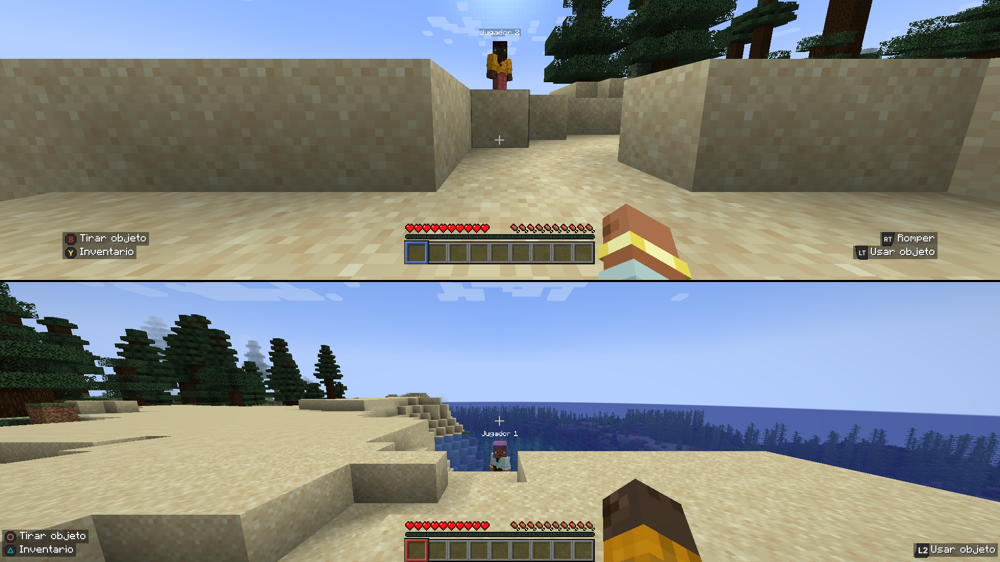
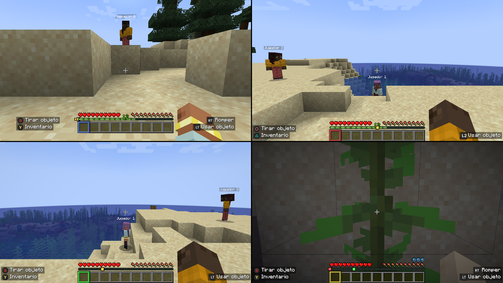
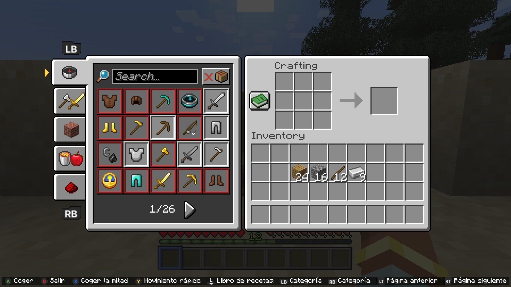
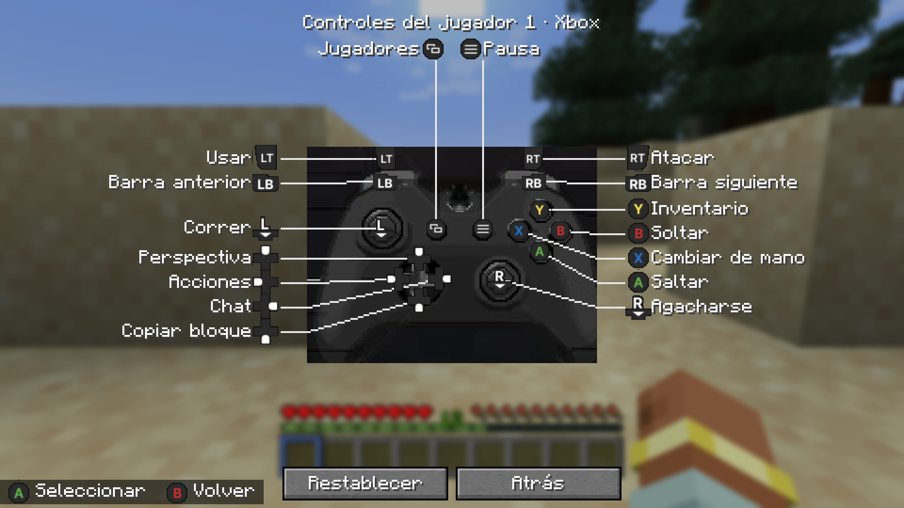
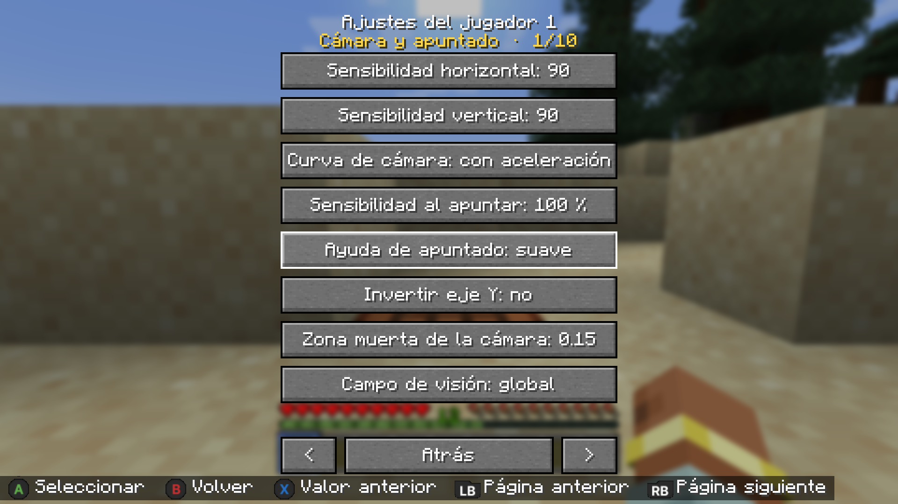

# ConsolePad 0.13.0-beta

**[Español](#español) · [English](#english)**

> Unofficial mod. Not affiliated with, endorsed by or associated with Mojang Studios or Microsoft. "Minecraft" is a trademark of Mojang Studios.
> Mod no oficial. No está afiliado a Mojang ni a Microsoft, ni cuenta con su respaldo.

---

## English

### What is it

A **Bedrock-style, controller-first experience for Minecraft Java** (NeoForge 1.21.1): gamepad support for every player and **local split screen for 2 to 4 players**. Each player has their own HUD, pause menu, inventory and screens, cursor, controller and settings, inside their own part of the screen.

This is a **beta**: it works end to end in my tests, but it has had little testing outside them. Please report problems.

### Features

- Xbox, PlayStation and Nintendo controllers (through GLFW), one per player, with prompts in the matching button style.
- Split screen for 2, 3 or 4 players (side by side or stacked), each with its own camera, field of view, HUD, chat, notices and boss bars.
- Per-player pause menu, inventory, containers, trading, anvil, enchanting, signs, on-screen keyboard and virtual cursor with D-pad navigation.
- Controls screen with a controller diagram (Xbox, PlayStation, Switch Pro or Joy-Con): each button is linked by a line to its current function, and you remap by picking a label and pressing the new button. Button icons can be switched per player (Xbox, PlayStation, Nintendo).
- Console-style crafting: recipe book with categories, LB/RB to change category, one button to craft.
- Quick actions wheel: hold the D-pad left button, pick an entry with the right stick and release to run it as a command (time, weather, game mode, heal, go to a player, bring a player...). Edit the entries in the game (player settings > "Quick wheel", each player can have their own) or in `config/consolepad/wheel.json` (shared by everyone). Assign controllers to players from each player's settings ("Assign controllers").
- Partner indicator, as in Bedrock's locator bar: a square in the partner's colour moves along your experience bar to show where the other player is (centre = straight ahead, an end = to that side or behind). Only the direction is shown by default; turn on "Partner distance" in player settings to also see their name and distance above your hearts. It appears from 10 blocks away and can be turned off ("Partner indicator").
- Rumble per player on controllers Windows sees as XInput (Xbox-compatible, or PlayStation/Nintendo through Steam Input): strength off/soft/normal/strong in player settings; it fires when you take damage or die, break a block, hit, eat, draw a bow or something blows up near you.
- The pause menu shows a preview of your player with your skin when there is room.
- Contextual button prompts: the use button says what it will do for what you are looking at ("Open", "Sleep", "Ride", "Trade", "Feed", "Milk", "Shear", "Eat"...), as on consoles.
- Per-player auto-jump (like the game's option, but each player picks "as the game / yes / no") and a paper doll: your character with your skin appears in a corner while you sprint, sneak, swim or glide (off in player settings).
- Items spread one by one with X held and the D-pad, as in Bedrock.
- Riding works for every player: jump bar and mount hearts in each HUD. D-pad targets for the stonecutter recipes and the loom patterns.
- Sound per player: each sound is played by the nearest local player (moved to the listener with its distance and direction kept), so what happens next to players 2 to 4 is heard. Ambient particles (torches, lava, portals) around every player.
- Player 1 can remove an extra player from the pause menu ("Remove a player"). Field of view compensation for narrow split-screen regions (off / half / full). Automatic performance: with several players, if the frame rate stays under 40 FPS the view distance and entity drawing are lowered a bit more and restored when there is room (`"adaptivePerformance"`, `"targetFps"` in `split.json`).
- Partner indicator extras: the marker blinks red when the partner is under 4 hearts, and "Mark my bed" adds a second, ring-shaped marker towards your bed or respawn point.
- More rumble: a fish biting, a soft heartbeat under 3 hearts, and a separate strength for damage, actions (hits, breaking, eating, bow, fishing) and the environment (explosions).
- Input: press **LB and RB together** to jump to the previously used hotbar slot (again to go back); new **Nintendo layout** (A and B, X and Y swapped, also in menus); speed of the repeat when holding the drop button.
- Performance: the world of a player with a menu open (it is blurred behind) is drawn with half the entities; under high pressure the automatic regulator also thins out particles; and a manual **Saving mode** (all players) starts at the regulator's level 2.
- Menus in English: the mod's menus start in Spanish; "Menu language" in player settings switches them to English, or to follow the language of Minecraft (auto).
- Player colours: the controller cursor, the selected hotbar slot and the partner marker use each player's colour (blue, red, green, yellow, or the label colour they chose); a thin black line separates the regions. Both can be turned off.
- A soft red flash on the edges of a player's region with 3 hearts or less, in time with the heartbeat (per player, can be turned off).
- Sleeping together: a notice on every screen says who is in bed and who is missing ("Sleeping: ..." / "Missing: ..."); it stays for 12 seconds and fades out, and can be turned off in settings.
- Brightness per player (as the game / 0 to 100 %): each region already has its own light map, so every player can have their own gamma.
- On-screen keyboard: it no longer pops up by itself in the chat, signs and name fields; press **Y** (or **A** on a text field) to open it and **B** to close it. "Automatic keyboard" in player settings brings the old behaviour back.
- Players 2 to 4 can get out of bed: they get a "Leave bed" screen like player 1 (**B** also works).
- Mob sounds get quieter through blocks (vanilla plays them at full volume through the floor). Turn it off with `"soundOcclusion": false` in `config/consolepad/split.json`.
- When a world opens with two or more controllers connected, the game asks "How many players?" and brings them all in one after another (turn it off with "No volver a preguntar" or `"askPlayers": false` in `config/consolepad/split.json`). The screen layout (side by side / stacked) is remembered per world.
- An extra player whose controller stays disconnected for 30 s leaves the game (their inventory is saved); change it with `"padLostLeaveSeconds"` in `split.json` (0 = never).
- Local profiles: each extra player can use a saved profile (name, label colour, one of the 18 default skins or your own 64x64 PNG from `config/consolepad/skins/`, settings). Each profile enters the world with its own account, so inventory, position and respawn point are per profile. Create them from the player settings ("Profile").
- Per-player settings: sensitivity, dead zones, camera curve, field of view, render distance, HUD margin and opacity, accessibility options, button layouts (default, Java, left-handed) and individual remapping.
- Automatic reduction of view distance and entity drawing with more players, to keep the frame rate (can be turned off).
- Players join with their controller (Start) and leave without affecting the others.

### Screenshots

| 4 players | Console-style crafting |
|---|---|
|  |  |

### Default controls

| Action | Button |
|---|---|
| Move / look | Left stick / right stick |
| Jump | A |
| Attack / break | RT |
| Use / place | LT |
| Drop item | B |
| Swap hands | X |
| Inventory | Y |
| Change hotbar slot | LB / RB |
| Sprint | L3 |
| Sneak | R3 |
| Change perspective | D-pad up |
| Pause menu | Start |
| Leave (joined players) | Hold Start + Back for 2 s |

Everything can be remapped per player from the pause menu.

### Requirements

- Minecraft **1.21.1** with **NeoForge 21.1.x** (tested with 21.1.92) and **Java 21**.
- One controller per player. P1 can also use keyboard and mouse.

### Installation

See [docs/INSTALL.md](docs/INSTALL.md) (in Spanish). In short: put `consolepad-0.13.0-beta.jar` in the `mods` folder of a NeoForge 1.21.1 instance, open a single-player world, connect a second controller and press Start on it.

### Known issues

- **Sodium and Iris:** the game starts and 4-player split screen renders correctly with Sodium 0.8.13 and Iris 1.8.14 on NeoForge 21.1.248. Iris shaders do not work with split screen (each player's pass is composited over the whole window and only the last one looks right), so ConsolePad turns shaders off while extra players are in and back on when one player is left (set `"keepShaders": true` in `config/consolepad/split.json` to keep them on). Other renderer mods are unverified.
- **Local worlds only** (single player, LAN, or servers without authentication): extra players connect from inside the game and cannot join an authenticated server.
- Rumble only works on XInput controllers (Windows). Sound per player moves other players' sounds to player 1's listener (distance and direction are kept; there is one OpenAL listener).
- An extra player whose controller disconnects stays paused with a notice until it returns.
- All local players use the host profile (same skin); a name tag tells them apart.
- More in [docs/splitscreen-roadmap.md](docs/splitscreen-roadmap.md).

### Credits

- Button icons: "Free Input Prompts" by **JulioCacko**, released under **CC0 1.0** (public domain). See [CREDITS](CREDITS).
- Built on [NeoForge](https://neoforged.net/).

### License

Not decided yet; until then, all rights reserved.

---

## Español

### Qué es

Una **experiencia estilo Bedrock con mando para Minecraft Java** (NeoForge 1.21.1): soporte de mandos para todos los jugadores y **pantalla dividida local de 2 a 4 jugadores**. Cada jugador tiene su propio HUD, menú de pausa, inventario y pantallas, cursor, mando y ajustes, dentro de su parte de la pantalla.

Es una **beta**: funciona de principio a fin en mis pruebas, pero se ha probado poco fuera de ellas. Avisa de los problemas que encuentres.

### Características

- Mandos Xbox, PlayStation y Nintendo (vía GLFW), uno por jugador, con iconos del estilo de cada mando.
- Pantalla dividida para 2, 3 o 4 jugadores (lado a lado o apilada), cada uno con su cámara, campo de visión, HUD, chat, avisos y barras de jefe.
- Menú de pausa, inventario, contenedores, comercio, yunque, encantamiento, carteles, teclado en pantalla y cursor virtual con navegación por cruceta, todo por jugador.
- Pantalla de controles con diagrama del mando (Xbox, PlayStation, Switch Pro o Joy-Con): cada botón se une con una línea a su función actual, y se remapea eligiendo una etiqueta y pulsando el botón nuevo. Los iconos de botones se pueden cambiar por jugador (Xbox, PlayStation, Nintendo).
- Indicador del compañero, como la barra de localización de Bedrock: un cuadrado del color del compañero se mueve por tu barra de experiencia y marca dónde está el otro jugador (centro = justo delante, un extremo = a ese lado o detrás). Por defecto solo se ve la dirección; activa «Distancia del compañero» en los ajustes del jugador para ver también su nombre y distancia sobre tus corazones. Sale desde 10 bloques y se puede apagar («Indicador del compañero»).
- Vibración por jugador en los mandos que Windows ve como XInput (compatibles con Xbox, o PlayStation/Nintendo por Steam Input): fuerza no/suave/normal/fuerte en los ajustes del jugador; salta al recibir daño o morir, romper un bloque, golpear, comer, tensar un arco o explotar algo cerca.
- El menú de pausa muestra una vista previa de tu jugador con su skin cuando hay sitio.
- Avisos de botones contextuales: el botón de usar dice qué hará con lo que miras («Abrir», «Dormir», «Montar», «Comerciar», «Dar de comer», «Ordeñar», «Esquilar», «Comer»...), como en consola.
- Salto automático por jugador (como la opción del juego, pero cada uno elige «como el juego / sí / no») y muñeco del jugador: tu personaje con tu skin sale en una esquina mientras corres, te agachas, nadas o planeas (se apaga en los ajustes del jugador).
- Los objetos se reparten de uno en uno con X mantenido y la cruceta, como en Bedrock.
- Las cabalgaduras funcionan para todos: barra de salto y corazones de la montura en cada HUD. La cruceta llega a las recetas de la mesa de corte y a los patrones del telar.
- Sonido por jugador: cada sonido lo reproduce el jugador local más cercano (movido al oyente conservando distancia y dirección), así que se oye lo que pasa junto a P2 a P4. Partículas ambientales (antorchas, lava, portales) alrededor de cada jugador.
- P1 puede sacar a un jugador extra desde el menú de pausa («Sacar a un jugador»). Compensación del campo de visión en regiones estrechas (no / media / total). Rendimiento automático: con varios jugadores, si los FPS se quedan por debajo de 40 se baja un poco más la distancia de visión y el dibujo de entidades, y se devuelve cuando hay margen (`"adaptivePerformance"`, `"targetFps"` en `split.json`).
- Extras del indicador: el marcador parpadea en rojo cuando el compañero tiene menos de 4 corazones, y «Marcar mi cama» añade un segundo marcador en forma de anillo hacia tu cama o punto de reaparición.
- Más vibración: un pez que pica, un latido suave con menos de 3 corazones y una fuerza por separado para daño, acciones (golpes, romper, comer, arco, pesca) y entorno (explosiones).
- Entrada: pulsa **LB y RB a la vez** para saltar a la casilla usada antes (otra vez, vuelve); nueva **disposición Nintendo** (A y B, X e Y intercambiados, también en los menús); velocidad de la repetición al mantener el botón de soltar.
- Rendimiento: el mundo de un jugador con un menú abierto (queda difuminado detrás) se dibuja con la mitad de entidades; con presión alta el regulador automático también adelgaza las partículas; y un **Modo ahorro** manual (todos los jugadores) empieza ya en el nivel 2 del regulador.
- Menús en inglés: los menús del mod empiezan en español; «Idioma de los menús» en los ajustes del jugador los pasa a inglés, o al idioma de Minecraft (automático).
- Colores por jugador: el cursor del mando, la casilla seleccionada de la barra y el marcador del compañero usan el color de cada jugador (azul, rojo, verde, amarillo, o el de la etiqueta que haya elegido); una línea fina negra separa las regiones. Ambas cosas se pueden apagar.
- Un destello rojo suave en los bordes de la región de un jugador con 3 corazones o menos, al ritmo del latido (por jugador, se puede apagar).
- Dormir juntos: un aviso en todas las pantallas dice quién está en la cama y quién falta («Durmiendo: ...» / «Faltan: ...»); dura 12 segundos y se difumina, y se apaga en los ajustes.
- Brillo por jugador (como el juego / 0 a 100 %): cada región ya tiene su propio mapa de luz, así que cada uno puede tener su gamma.
- Teclado en pantalla: ya no sale solo en el chat, los carteles y los nombres; pulsa **Y** (o **A** sobre un campo de texto) para abrirlo y **B** para cerrarlo. «Teclado automático» en los ajustes del jugador devuelve el comportamiento anterior.
- Los jugadores 2 a 4 pueden levantarse de la cama: tienen su pantalla «Salir de la cama» como el jugador 1 (también vale **B**).
- Los sonidos de los mobs bajan de volumen detrás de bloques (vanilla los oye a tope a través del suelo). Se apaga con `"soundOcclusion": false` en `config/consolepad/split.json`.
- Al abrir un mundo con dos o más mandos conectados, el juego pregunta «¿Cuántos jugadores sois?» y mete a todos uno tras otro (se apaga con «No volver a preguntar» o `"askPlayers": false` en `config/consolepad/split.json`). El reparto de pantalla (lado a lado / apilado) se recuerda por mundo.
- Un jugador extra cuyo mando lleva 30 s desconectado sale de la partida (su inventario se guarda); se cambia con `"padLostLeaveSeconds"` en `split.json` (0 = nunca).
- Perfiles locales: cada jugador extra puede usar un perfil guardado (nombre, color de etiqueta, una de las 18 skins por defecto o un PNG propio de 64x64 de `config/consolepad/skins/`, y sus ajustes). Cada perfil entra al mundo con su propia cuenta, así que el inventario, la posición y el punto de reaparición son por perfil. Se crean desde los ajustes del jugador («Perfil»).
- Rueda de acciones rápidas: mantén la cruceta izquierda, elige con el stick derecho y suelta para ejecutar un comando (hora, clima, modo de juego, curarte, ir con alguien, traer a alguien...). Las entradas se editan en el juego (ajustes del jugador > «Rueda de acciones», cada jugador puede tener la suya) o en `config/consolepad/wheel.json` (la de todos). Los mandos se asignan a cada jugador desde sus ajustes («Asignar mandos»).
- Crafteo estilo consola: libro de recetas con categorías, LB/RB para cambiar de categoría y un botón para fabricar.
- Ajustes por jugador: sensibilidad, zonas muertas, curva de cámara, campo de visión, distancia de visión, margen y opacidad del HUD, accesibilidad, disposiciones de botones (de fábrica, Java, zurdo) y remapeo individual.
- Reducción automática de distancia de visión y dibujo de entidades con más jugadores, para mantener los fotogramas (se puede desactivar).
- Los jugadores entran con su mando (Start) y salen sin afectar a los demás.

### Capturas

Ver arriba: 2 jugadores, 4 jugadores, crafteo estilo consola y ajustes del jugador.

### Controles por defecto

| Acción | Botón |
|---|---|
| Moverse / mirar | Stick izquierdo / stick derecho |
| Saltar | A |
| Atacar / romper | RT |
| Usar / colocar | LT |
| Soltar objeto | B |
| Cambiar de mano | X |
| Inventario | Y |
| Cambiar de casilla | LB / RB |
| Correr | L3 |
| Agacharse | R3 |
| Cambiar perspectiva | Cruceta arriba |
| Menú de pausa | Start |
| Salir (jugadores unidos) | Mantener Start + Back 2 s |

Todo se puede remapear por jugador desde el menú de pausa.

### Requisitos

- Minecraft **1.21.1** con **NeoForge 21.1.x** (probado con 21.1.92) y **Java 21**.
- Un mando por jugador. P1 también puede usar teclado y ratón.

### Instalación

Ver [docs/INSTALL.md](docs/INSTALL.md). En resumen: copia `consolepad-0.13.0-beta.jar` a la carpeta `mods` de una instancia de NeoForge 1.21.1, abre un mundo de un jugador, conecta un segundo mando y pulsa Start en él.

### Problemas conocidos

- **Sodium e Iris:** el juego arranca y la pantalla dividida de 4 jugadores se dibuja bien con Sodium 0.8.13 e Iris 1.8.14 en NeoForge 21.1.248. Los shaders de Iris no funcionan con la pantalla dividida (cada pasada se compone sobre toda la ventana y solo la última se ve bien), así que ConsolePad los apaga mientras haya jugadores extra y los vuelve a encender al quedar uno (con `"keepShaders": true` en `config/consolepad/split.json` se dejan puestos). Otros mods de renderizado, sin verificar.
- **Solo mundos locales, LAN o servidores sin autenticación:** los jugadores extra se conectan por dentro del juego y no pueden entrar en un servidor con autenticación.
- La vibración solo funciona en mandos XInput (Windows). El sonido por jugador mueve los sonidos de los demás al oyente de P1 (se conservan distancia y dirección; OpenAL tiene un solo oyente).
- Un jugador extra con el mando desconectado queda en pausa con un aviso hasta que el mando vuelva.
- Todos los jugadores locales usan el perfil del anfitrión (misma skin); se distinguen por una etiqueta con nombre.
- Más en [docs/splitscreen-roadmap.md](docs/splitscreen-roadmap.md).

### Créditos

- Iconos de botones: «Free Input Prompts» de **JulioCacko**, publicado bajo **CC0 1.0** (dominio público). Ver [CREDITS](CREDITS).
- Construido sobre [NeoForge](https://neoforged.net/).

### Licencia

Sin decidir todavía; hasta entonces, todos los derechos reservados.

### Aviso

Este mod no está afiliado a Mojang ni a Microsoft. «Minecraft» es una marca de Mojang Studios.
